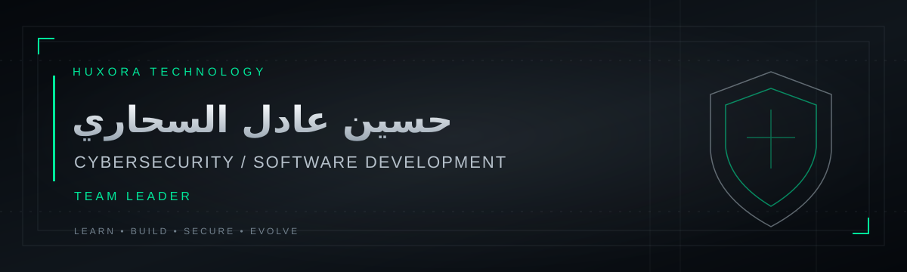

# Hussein Adel
### قائد فريق HUXORA Technology · طالب أمن سيبراني · مطوّر برمجيات

**أتعلم · أبني · أحمي · أتطور**

---

## 👨‍💻 نبذة عني

طالب أمن سيبراني وقائد فريق **HUXORA Technology**، مهتم بتطوير البرمجيات، وأنظمة الحاسوب، وبناء مشاريع تقنية عملية. أؤمن أن التعلم الحقيقي يبدأ بالتطبيق والتجربة والاستمرار في التطوير.

- 🎓 طالب أمن سيبراني
- 👥 قائد فريق **HUXORA Technology**
- 🛡️ مهتم بالأمن الدفاعي، الشبكات، وإدارة الأنظمة
- 💻 أتعلم وأطوّر باستخدام لغات البرمجة وتقنيات الويب
- 🔧 أحوّل المعرفة النظرية إلى تطبيقات ومشاريع عملية
- 🌱 أسعى إلى تطوير مهاراتي واكتساب خبرة عملية باستمرار

---

## 🧰 التقنيات والأدوات

### لغات البرمجة

### تطوير الويب

### قواعد البيانات

### الأمن السيبراني والأنظمة والأدوات

تعكس التقنيات أعلاه ما أدرسه أو أستكشفه أو استخدمته ضمن مشاريعي، وليست ادعاءً بإتقان جميع الأدوات.

---

## 🚀 المشاريع

### 🛡️ CYRO — منصة مراقبة الأمن السيبراني
مشروع ضمن فريق يهدف إلى استكشاف المراقبة الأمنية، جمع بيانات الخوادم، وتوفير رؤية مركزية مستوحاة من بيئات SOC.

- مراقبة الخوادم وجمع البيانات (Telemetry)
- تكامل مع Windows Server Agent
- لوحة مركزية للمراقبة والرؤية الأمنية
- واجهة ومهام تركز على المراقبة الأمنية

**روابط المشروع:** [مستودع GitHub](https://github.com/hasseensahaeri-ux/CYRO) · [التجربة المباشرة](https://cyro-7uc6.onrender.com)

### 🎓 UniFlow — واجهة نظام جامعي
مشروع واجهة ويب لنظام جامعي، يستكشف الخدمات الرقمية الموجهة للطلاب وتنظيم العمليات الجامعية.

**المستودع:** [uniflow-university-system-](https://github.com/hasseensahaeri-ux/uniflow-university-system-)

### 🧩 Doctors Tower — Java
مشروع Java ضمن رحلتي في تعلم تطوير البرمجيات واكتساب الخبرة البرمجية.

**المستودع:** [doctors-tower-java](https://github.com/hasseensahaeri-ux/doctors-tower-java)

---

## 📚 أتعلم وأستكشف حاليًا

- الأمن السيبراني والأمن الدفاعي
- أساسيات الشبكات
- Linux وإدارة الأنظمة
- برمجة Python
- Java و C++
- تطوير الويب
- SQL وتصميم قواعد البيانات
- الأنظمة الافتراضية والبنية التحتية

---

## 📊 إحصائيات GitHub

---

### الفضول يقود التعلم، والانضباط يصنع التطور، والعمل يحوّل الأفكار إلى واقع.

